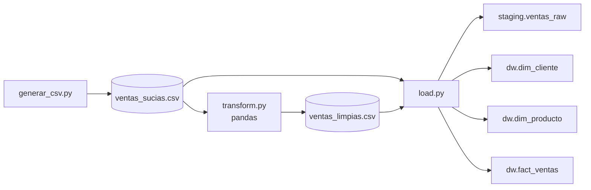

# Pipeline ETL de Ventas con Python y SQL Server

Proyecto de práctica que implementa un pipeline ETL completo: extrae un archivo CSV de ventas con errores a propósito, lo limpia con Python y lo carga en SQL Server (en Docker), primero como dato crudo en una zona de *staging* y luego como un modelo de estrella listo para análisis.

## Qué demuestra este proyecto

- **Extract:** lectura y perfilamiento de datos sucios (nulos, duplicados, formatos mezclados).
- **Transform:** limpieza y estandarización con pandas, con chequeos de calidad.
- **Load:** carga a SQL Server con staging, dimensiones y tabla de hechos.
- **SQL analítico:** consultas con `JOIN`, `GROUP BY`, CTE y funciones de ventana.
- **Infraestructura reproducible:** SQL Server levantado con Docker Compose, con la base y los esquemas creados automáticamente.
- **Buenas prácticas:** credenciales en `.env`, carga transaccional e idempotente.

## Stack

| Componente | Tecnología |
|---|---|
| Lenguaje | Python 3 |
| Procesamiento | pandas |
| Conexión a BD | SQLAlchemy + pyodbc (ODBC Driver 18) |
| Base de datos | SQL Server 2022 |
| Infraestructura | Docker y Docker Compose |
| Configuración | python-dotenv |

## Arquitectura



## Modelo de datos

El esquema `staging` guarda el dato crudo, tal como llegó. El esquema `dw` guarda el dato limpio en un **modelo de estrella**:

```
 dw.dim_cliente
       |
 dw.fact_ventas --- dw.dim_producto
```

| Tabla | Tipo | Contenido |
|---|---|---|
| `staging.ventas_raw` | Staging | Copia fiel del CSV, con duplicados y errores |
| `dw.dim_cliente` | Dimensión | Un registro por cliente |
| `dw.dim_producto` | Dimensión | Un registro por producto |
| `dw.fact_ventas` | Hechos | Una fila por venta, con claves hacia las dimensiones, cantidad, precio y total |

## Limpieza aplicada (Transform)

| Problema en los datos | Solución |
|---|---|
| 10 filas duplicadas | `drop_duplicates` por `id_venta` |
| Nombres con espacios y mayúsculas inconsistentes | `strip()` y `title()` |
| Fechas en 3 formatos (`YYYY-MM-DD`, `DD/MM/YYYY`, `DD-MM-YYYY`) | Función que prueba cada formato y devuelve `NaT` si ninguno calza |
| Precios nulos | Se rellenan con el precio habitual del mismo producto |
| Falta el total de cada venta | Columna calculada `total = cantidad * precio_unitario` |

Los supuestos de la limpieza (por ejemplo, que `05-08-2026` es día/mes/año) son decisiones que en un caso real se confirman con el dueño de los datos.

## Estructura del repositorio

```
sales_pipeline/
├── docker-compose.yml     # SQL Server + servicio de inicialización
├── init.sql               # Crea la base mini_etl y los esquemas staging y dw
├── .env.example           # Plantilla de variables de entorno
├── requirements.txt       # Dependencias de Python
├── db.py                  # Conexión a SQL Server (lee la contraseña del .env)
├── generar_csv.py         # Genera ventas_sucias.csv con errores a propósito
├── extract.py             # Perfilamiento de los datos crudos
├── transform.py           # Limpieza y generación de ventas_limpias.csv
├── load.py                # Carga a staging y al modelo de estrella
└── test_conexion.py       # Prueba rápida de conexión
```

## Requisitos previos

- Docker Desktop (o Docker Engine con Compose)
- Python 3.10 o superior
- **ODBC Driver 18 for SQL Server** instalado en tu máquina (es el driver que usa `pyodbc`; el driver antiguo `SQL Server` que trae Windows no sirve)

## Cómo ejecutarlo

### 1. Clona el repositorio y crea el entorno virtual

```bash
git clone <URL_DEL_REPOSITORIO>
cd sales_pipeline
python -m venv .venv
```

Actívalo:

```bash
# Windows (PowerShell)
.venv\Scripts\Activate.ps1

# Mac / Linux
source .venv/bin/activate
```

```bash
pip install -r requirements.txt
```

### 2. Configura la contraseña

Copia la plantilla y edita el valor:

```bash
cp .env.example .env
```

```
MSSQL_SA_PASSWORD=TuContraseñaSegura123
```

La contraseña debe tener al menos 8 caracteres y mezclar mayúsculas, minúsculas y números (política de SQL Server). El archivo `.env` está en `.gitignore` y no se sube al repositorio.

### 3. Levanta SQL Server

```bash
docker compose up -d
docker compose ps
```

Espera a que `sqlserver` aparezca como `healthy`. El servicio `init` crea la base `mini_etl` y los esquemas `staging` y `dw`, y luego termina (`Exited (0)` es lo esperado).

### 4. Verifica la conexión

```bash
python test_conexion.py
```

Debe imprimir `[('staging',), ('dw',)]`.

### 5. Ejecuta el pipeline

```bash
python generar_csv.py   # crea ventas_sucias.csv
python extract.py       # explora los datos crudos
python transform.py     # crea ventas_limpias.csv
python load.py          # carga a SQL Server
```

`load.py` debe imprimir `Staging: 210 filas | Hechos: 200 filas`.

Los CSV no se suben al repositorio: se regeneran con los scripts.

## Consultas de ejemplo

**Ventas por mes**

```sql
SELECT FORMAT(fecha, 'yyyy-MM') AS mes,
       COUNT(*) AS n_ventas,
       SUM(total) AS total_vendido
FROM dw.fact_ventas
GROUP BY FORMAT(fecha, 'yyyy-MM')
ORDER BY mes;
```

**Top 3 productos por ingresos**

```sql
SELECT TOP 3 p.nombre, SUM(f.total) AS ingresos
FROM dw.fact_ventas f
JOIN dw.dim_producto p ON p.id_producto = f.id_producto
GROUP BY p.nombre
ORDER BY ingresos DESC;
```

**Mejor cliente de cada producto (CTE + función de ventana)**

```sql
WITH compras AS (
    SELECT p.nombre AS producto, c.nombre AS cliente, SUM(f.total) AS gastado
    FROM dw.fact_ventas f
    JOIN dw.dim_cliente c ON c.id_cliente = f.id_cliente
    JOIN dw.dim_producto p ON p.id_producto = f.id_producto
    GROUP BY p.nombre, c.nombre
),
ranking AS (
    SELECT *, ROW_NUMBER() OVER (PARTITION BY producto ORDER BY gastado DESC) AS pos
    FROM compras
)
SELECT producto, cliente, gastado
FROM ranking
WHERE pos = 1;
```

**Total acumulado por mes**

```sql
WITH mensual AS (
    SELECT FORMAT(fecha, 'yyyy-MM') AS mes, SUM(total) AS total_mes
    FROM dw.fact_ventas
    GROUP BY FORMAT(fecha, 'yyyy-MM')
)
SELECT mes, total_mes,
       SUM(total_mes) OVER (ORDER BY mes) AS acumulado
FROM mensual
ORDER BY mes;
```

## Decisiones de diseño

- **Staging separado del DW:** el dato crudo se conserva sin tocar, así se puede reprocesar si cambia una regla de limpieza.
- **Modelo de estrella:** evita repetir texto en cada venta y permite agrupar por cualquier dimensión.
- **Carga transaccional:** `load.py` usa una transacción, de modo que si algo falla a mitad de camino no queda la base a medias.
- **Idempotencia:** el script recrea las tablas del DW en cada ejecución, por lo que correrlo varias veces deja el mismo resultado.
- **Credenciales fuera del código:** la contraseña vive en `.env` y la conexión se arma con `URL.create`, que escapa correctamente caracteres especiales.
- **Healthcheck en Compose:** el servicio de inicialización solo corre cuando SQL Server ya acepta conexiones.

## Solución de problemas

| Síntoma | Causa probable |
|---|---|
| `Login failed for user 'sa'` | La contraseña del `.env` no coincide con la del volumen. Usa `docker compose down -v` y levanta de nuevo |
| `Login timeout expired` | SQL Server aún está arrancando. Espera al estado `healthy` |
| `Data source name not found` | Falta instalar el ODBC Driver 18 for SQL Server |
| `Falta MSSQL_SA_PASSWORD` | Ejecuta los scripts desde la carpeta del proyecto y revisa que exista el `.env` |

Para borrar todo y empezar de cero (incluye los datos):

```bash
docker compose down -v
```

## Próximos pasos

- Reimplementar el mismo flujo con Pentaho Data Integration.
- Agregar logging y una tabla de control para registrar cada ejecución.
- Pasar de recarga completa a carga incremental.
- Añadir pruebas automáticas para las reglas de limpieza.
- Conectar el modelo a un dashboard en Power BI.

## Autor

**David Martínez Escares**, Ingeniero en Ejecución en Computación e Informática (USACH)
[linkedin.com/in/david-martinez-esc](https://linkedin.com/in/david-martinez-esc)
